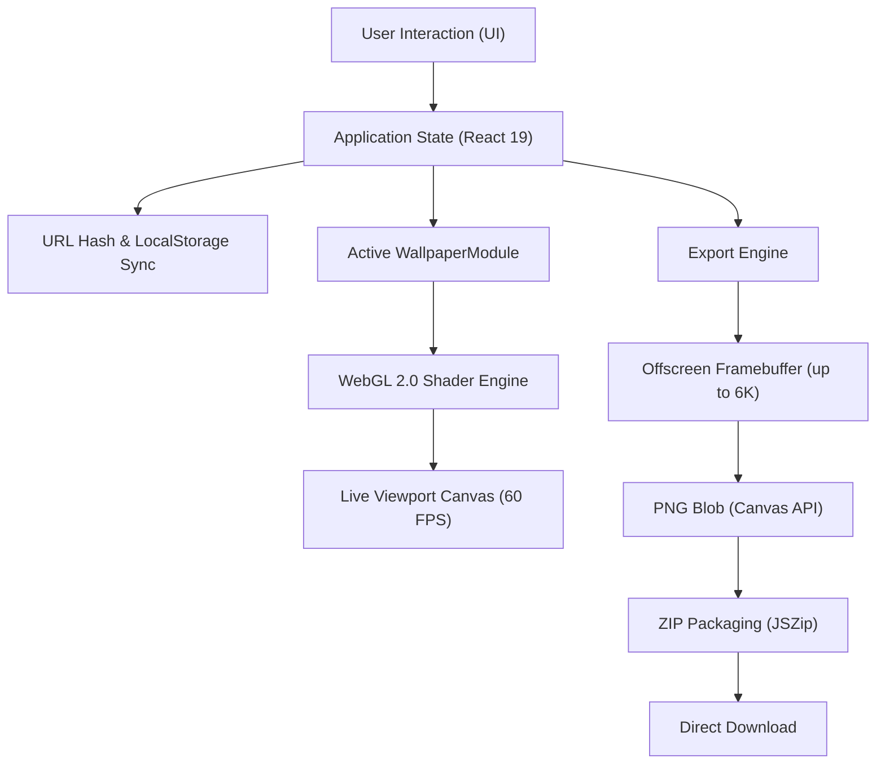

# Architecture & Technical Design

This document details the engineering design, mathematical foundations, and rendering pipeline of **Lumina Wallpaper Studio**.

---

## 1. High-Level System Architecture

Lumina is built entirely on web standards with zero backend dependencies:



---

## 2. Pluggable Wallpaper Modules (`src/modules/`)

All wallpaper generators implement the standard `WallpaperModule` contract:

```typescript
export interface WallpaperModule<TParams = Record<string, unknown>> {
  id: string;
  name: string;
  description: string;
  thumbnailUrl?: string;
  defaultParams: TParams;
  CustomControls?: React.FC<{
    params: TParams;
    onChange: (newParams: TParams) => void;
  }>;
  renderWebGL: (
    gl: WebGL2RenderingContext,
    options: RenderOptions<TParams>
  ) => void;
  renderFallback?: (
    ctx: CanvasRenderingContext2D,
    options: RenderOptions<TParams>
  ) => void;
}
```

### Module Lifecycle
1. **Selection**: User chooses a module in Step 1 (or loads one via URL hash).
2. **Configuration**: Module parameters (`defaultParams`) merge with user customizations and active device dimensions.
3. **Rendering Hook**: The rendering engine invokes `renderWebGL(gl, options)` on every animation frame for the live viewport, and once offscreen at target resolution when exporting.

---

## 3. Mathematical Foundations: Glass Pills Module

The **Glass Pills** module is an exact mathematical port of the SDF and lighting calculations originally developed in Python (`pills_wallpaper_improved.sh`):

### Signed Distance Field (SDF) of a Capsule
Given a point $P = (p_x, p_y)$ relative to the capsule center $(c_x, c_y)$, capsule radius $r = w / 2$, and straight segment half-length $h_{\text{half}} = h / 2 - r$:

$$d_y = p_y - \text{clamp}(p_y, -h_{\text{half}}, h_{\text{half}})$$
$$\text{dist} = \sqrt{p_x^2 + d_y^2}$$
$$d = \text{dist} - r$$

Where:
- $d < 0$ denotes pixels strictly inside the capsule.
- $d = 0$ is the capsule boundary.
- $d > 0$ denotes pixels in the surrounding space (shadows and diffuse glow).

### Lighting & Sigmoidal Transfer
Within the capsule, internal illumination $L$ is modulated using a logistic sigmoid:

$$\sigma(x) = \frac{1}{1 + e^{-x}}$$
$$L = 0.06 + 0.65 \cdot \sigma(\text{arg})^{1.1}$$

Where $\text{arg}$ incorporates vertical normalized coordinate $v_n$, horizontal coordinate $u_n$, pill index $i$, and stagger offset:

$$\text{arg} = \left(-1.5 v_n - 0.05 - 0.55 u_n - 0.35 k k u_n + 0.5 k k + 0.1 \sin(1.7 i)\right) \times 3.0$$

### Triple Rim Light & Caustic Reflections
Glass reflections are synthesized using three exponential layers:
1. **Sharp boundary rim**: $\exp(-|d| / (4.5 s)) \times (0.22 + 0.9 \cdot \text{facing}^2)$
2. **Intermediate reflection**: $\exp(-|d + 10s| / (7s)) \times 0.10 \times (0.4 + \text{facing})$
3. **Internal caustic refraction**: $\exp(-|d + 58s| / (5s)) \times 0.45 \times \text{bottom} \times (0.3 + \text{clamp}(n_y, 0, 1))$

### Dithering
To eliminate 8-bit banding on subtle dark gradients, high-frequency triangular noise is added prior to 8-bit quantization:

$$\text{noise} = \frac{\text{rand}(x, y) - 0.5}{255} \times 1.2$$

---

## 4. macOS Dynamic Wallpaper Architecture

macOS supports dynamic wallpapers that transition between Light and Dark modes using an Apple-specific XMP tag embedded inside a multi-image ISOBMFF HEIC container:

```xml
<x:xmpmeta xmlns:x="adobe:ns:meta/" x:xmptk="XMP Core 6.0.0">
  <rdf:RDF xmlns:rdf="http://www.w3.org/1999/02/22-rdf-syntax-ns#">
    <rdf:Description rdf:about="" xmlns:apple_desktop="http://ns.apple.com/namespace/1.0/"
      apple_desktop:apr="YnBsaXN0MDDSAQIDBFFsUWQQABABCA0PERMAAAAAAAABAQAAAAAAAAAFAAAAAAAAAAAAAAAAAAAAFQ=="/>
  </rdf:RDF>
</x:xmpmeta>
```

Where `apple_desktop:apr` encodes the binary Apple property list `{"l": 0, "d": 1}` mapping image index 0 to Light mode and image index 1 to Dark mode.

### 100% In-Browser Native HEIC Assembly:
Rather than relying on heavy WebAssembly builds or sending user data to backend servers, Lumina accomplishes dynamic HEIC generation completely inside the user's browser:
1. **Hardware-Accelerated WebCodecs**: Uses browser-native `VideoEncoder` with Apple VideoToolbox hardware acceleration (`hvc1.1.6.L150.B0` / `L180.B0`) to encode both Light and Dark frames as raw keyframe NAL units.
2. **Pure TypeScript ISOBMFF Muxer**: Assembles the ISO Base Media File Format box hierarchy (`ftyp`, `meta`, `hdlr`, `pitm`, `iinf`, `iref`, `iprp`, `iloc`, `mdat`) in `src/engine/heic.ts`.
3. **1-Click Native Output**: Produces a single `Lumina_[Name]_Dynamic.heic` file directly downloadable by the user. Right-clicking the file on macOS and selecting *Set Desktop Picture* instantly activates automatic day/night dynamic appearance switching!

---

## 5. Performance & Offscreen Tiling

WebGL implementations on mobile or integrated GPUs often cap `MAX_VIEWPORT_DIMS` or `MAX_RENDERBUFFER_SIZE` at 4096 or 8192 pixels.

When a user requests a 6K (6016×3384) or 2× supersampled wallpaper:
1. The exporter queries `gl.getParameter(gl.MAX_RENDERBUFFER_SIZE)`.
2. If the requested resolution exceeds this limit, the rendering pipeline divides the image into horizontal/vertical tiles, renders each tile into the FBO, and draws each tile onto an offscreen 2D canvas to stitch the final PNG cleanly without memory crashes.
